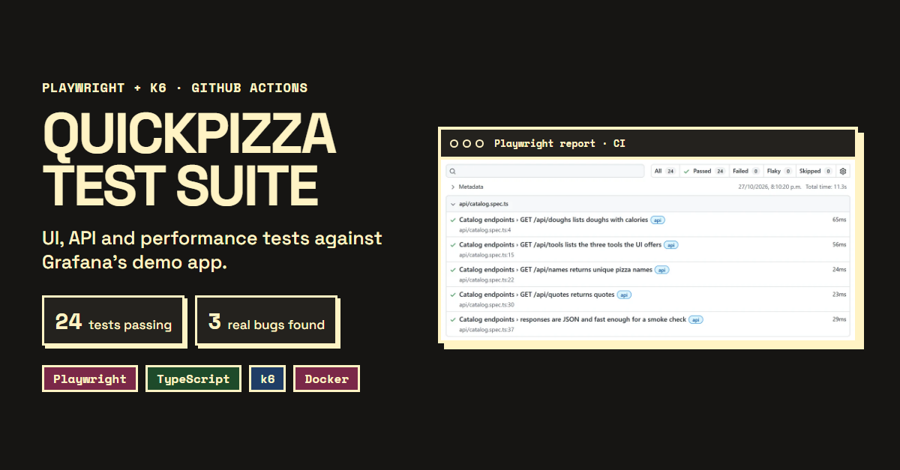

# QuickPizza Test Suite: Playwright + k6

[](https://github.com/ErosCalvimonti/playwright-k6-quickpizza/actions/workflows/ci.yml)



End-to-end quality suite for [QuickPizza](https://github.com/grafana/quickpizza), the demo app Grafana publishes for testing practice. It covers three layers:

| Layer | Tool | What it checks |
|---|---|---|
| **API** | Playwright `request` + TypeScript | Recommendation contract, business rules (vegetarian, excluded tools/ingredients, toppings), catalog endpoints, negative cases |
| **UI** | Playwright (Chromium + Firefox) | The page shows exactly what the API returned, advanced options are sent correctly, unauthenticated rating flow |
| **Performance** | k6 (TypeScript) | Smoke and ramping load test with per-endpoint SLO thresholds and custom metrics |

Everything runs in **GitHub Actions against a disposable QuickPizza container**, so results don't depend on a shared host and the load test can't hurt anyone's demo.

## Project structure

```
src/
├── api/PizzaApi.ts        # typed API client + domain helpers
├── pages/HomePage.ts      # Page Object for the home page
└── fixtures/index.ts      # custom fixtures: pizzaApi, homePage
tests/
├── api/                   # contract, business rules, negative cases, known defects
└── ui/                    # UI flows, UI ↔ API consistency
k6/
├── lib/                   # config, user journey, summary export
└── scenarios/             # smoke.ts, load.ts
.github/workflows/ci.yml   # Playwright job → k6 job, both with a QuickPizza service container
```

## Running locally

```bash
npm ci
npx playwright install chromium firefox

npm test              # all projects (api, chromium, firefox)
npm run test:api      # API only
npm run test:ui       # UI only
npm run report        # open the HTML report

npm run k6:smoke      # needs k6 installed: https://grafana.com/docs/k6/latest/set-up/install-k6/
npm run k6:load
```

By default tests target the public demo `https://quickpizza.grafana.com`. To run against your own instance:

```bash
docker run --rm -p 3333:3333 ghcr.io/grafana/quickpizza-local:latest
BASE_URL=http://localhost:3333 npm test
BASE_URL=http://localhost:3333 VUS=50 npm run k6:load
```

The load test caps itself at 5 virtual users when it points at the public demo.

## Design decisions

- **Page Object + fixtures.** Tests read like scenarios (`homePage.setAdvanced(...)`, `pizzaApi.recommend(...)`); selectors live in one place.
- **UI tests verify against the network.** Instead of hard-coding expected pizzas, UI tests capture the `/api/pizza` response the click triggered and assert the page renders exactly that. This keeps them deterministic even though recommendations are random.
- **Randomness is sampled, not ignored.** Business rules are checked over several recommendations, not one lucky response.
- **Known bugs are `test.fail()`, not skipped.** They stay visible in every run and turn red the day they're fixed, so the expectation gets updated on purpose.
- **Per-endpoint performance SLOs.** k6 requests are tagged (`recommend`, `tools`, `doughs`) and each has its own p95/p99 threshold; any breach fails the pipeline.
- **No account creation.** The suite only uses public, anonymous endpoints.

## Findings

Issues found while building the suite, confirmed against the [QuickPizza source](https://github.com/grafana/quickpizza):

| ID | Severity | Finding | Evidence |
|---|---|---|---|
| F-01 | Medium | `calories` (shown as *Calories per slice*) ignores the dough. `CalculateCalories()` only sums ingredients, so a Stuffed-dough pizza looks 300 kcal lighter than it is. | `tests/api/pizza-recommendation.spec.ts` › Known defects |
| F-02 | High | `maxCaloriesPerSlice` is not enforced. The generator retries 10 times and then returns the last pizza **even if it breaks the limit**, with `200 OK` (e.g. limit 300 → 900 kcal pizza). | `tests/api/pizza-recommendation.spec.ts` › Known defects |
| F-03 | Low (a11y) | The three numeric inputs in *Advanced* share `id="floating_filled"`, so every `<label for>` points to the first one. Screen readers and `getByLabel()` can't tell them apart. | Worked around in `src/pages/HomePage.ts` |

## License

MIT
